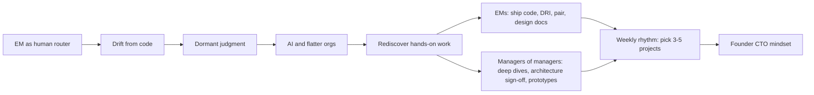

# Nobody needs a human router

**Source:** https://theengineeringmanager.substack.com/p/nobody-needs-a-human-router
**Author:** James Stanier
**Published:** 2026-09-15

---

## TLDR

Engineering managers drifted into being "information routers" who move context up and down the org. With AI tooling and flatter organizations, they should get hands-on again, because the technical judgment they built as ICs is dormant, not lost.

---

## Key Takeaways

- The judgment you built as an IC is pattern recognition, and it transfers across languages and stacks. Fundamentals like architecture, caching, queues, idempotency and backpressure stay stable.
- AI lowers the cost of relearning frameworks and tooling, so managers can contribute code, pair, and investigate problems again.
- EMs should ship code, act as DRI on a project, pair on hard problems as they happen, and co-author design docs.
- Managers of managers should go deep on two or three critical projects each week, own architecture sign-off, and prototype big technical bets.
- Try three things this week: go deep on one cross-cutting project, pair with two or three ICs, and drive the AI-assisted analysis in the next incident.

---

## Summary

Stanier describes how managers slowly stepped away from code as companies grew, added layers, and filled calendars with meetings. Hands-on leaders were often seen as micromanagers, which he calls ironic given what companies now want. He argues that the role of "human router" is no longer needed: AI tooling and flatter organizations push managers back toward the technical work.

His main point is that expertise is pattern recognition. He cites chess research and Kahneman and Klein's work on expert intuition, which is reliable in domains with real regularities. At Nordhealth, he spotted familiar problems within weeks: uptime issues, ORM query problems and missing circuit breakers. Fundamentals are durable, and AI makes the changing parts (frameworks, tools) faster to relearn.

He gives concrete practices. EMs contribute code, act as DRI, pair, and co-write design docs. Managers of managers do weekly deep dives, take accountability for architecture sign-off (as directors did at Shopify with the GSD system), and prototype technical bets. His own weekly rhythm: scan engineer-written DRI updates in Linear, pick three to five projects that need attention, and go direct through messages or Wednesday office hours. Tuesdays and Thursdays have no meetings. In pairing, AI acts as a third participant. In incidents, the manager drives the AI prompt instead of taking notes. He also mentions Will Larson, who reportedly merged more PRs in six months at Imprint than in the prior decade.

Stanier says that hands-on work made his job more engaging and that he now feels like a "founder CTO" across his scope. Managers who were once ICs already have the skills, and AI makes it easier to use them again.

---

## Diagram

### Diagram Explanation

Read the diagram from left to right. It shows how managers drifted into routing information, how AI and flatter orgs make hands-on work possible again, the practices for each manager level, and the resulting "founder CTO" mindset.
